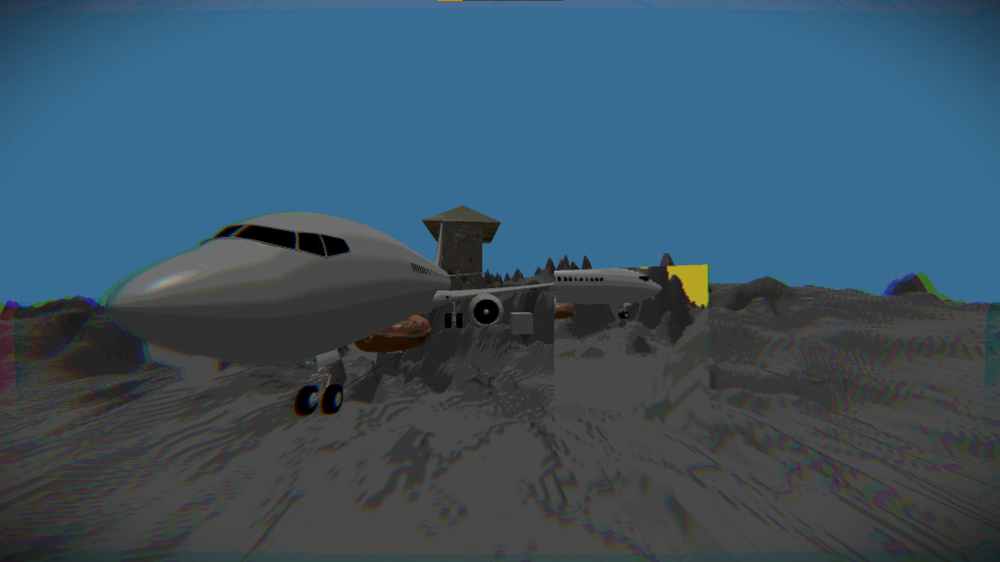

A playground project with a lot of random features. Began from the learnOpenGL tutorial. Added various other additions.
  heightmaps,
  framebuffer mirrors (framebuffer resolution also dynamically increases/decreases with distance to reduce compute)
  lighting,
  some random post processing filters (one that mimics a buckshot roulette filter)
  some free 3D assets + assimp. 

  
